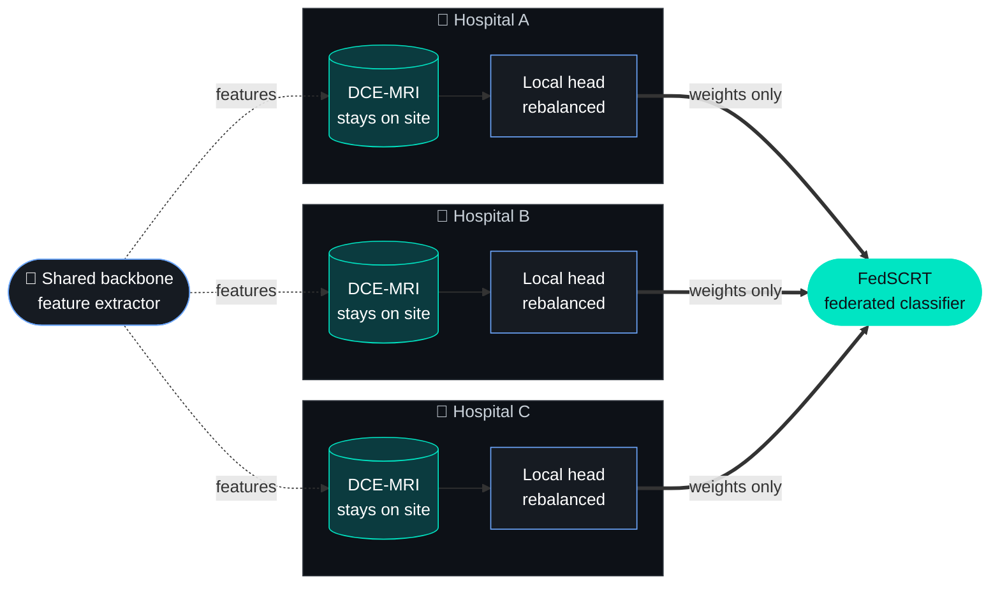

<div align="center">



<br/>

[](https://www.bensefiayazid.site/projects)
[](https://www.linkedin.com/in/bensefia-yazid-7604a9317/)
[](mailto:bensefiayazid@gmail.com)
[](https://maps.google.com/?q=Algiers)
[](https://github.com/AlphaaCode?tab=followers)

</div>

---

## 👨‍💻 About Me

<table>
<tr>
<td width="62%" valign="top">

```console
yazid@algiers:~$ whoami
Yazid Bensefia, software engineer

yazid@algiers:~$ cat now.txt
studying   MSc Bioinformatics @ USTHB (2026)
thesis     federated learning, breast DCE-MRI
ships      Next.js / NestJS / FastAPI / Flutter
languages  FR / EN / AR products, RTL included

yazid@algiers:~$ echo $PROBLEM
medical data is small, imbalanced, locked in hospitals
```

I build models that learn from scans they never get to see, and the apps clinicians use to reach them.

</td>
<td width="38%" align="center" valign="middle">


</td>
</tr>
</table>

---

## 🧬 The problem I work on

Hospitals can't pool their MRI scans, so no single site has enough data, and what each does have is heavily imbalanced. In my thesis, each hospital trains on its own data against one shared backbone, and only the small classifier heads travel.



<sub>Code: <a href="https://github.com/AlphaaCode/FedSCRT-model">FedSCRT-model</a> · the product around it: <a href="https://github.com/AlphaaCode/fedmri-app">fedmri-app</a></sub>

---

## 🛰️ Tech Stack

<div align="center">

**Daily drivers**


**Also used**


<sub>scikit-learn &nbsp;·&nbsp; Hugging Face &nbsp;·&nbsp; timm &nbsp;·&nbsp; SimpleITK &nbsp;·&nbsp; Flower &nbsp;·&nbsp; TanStack Query &nbsp;·&nbsp; shadcn/ui</sub>

</div>

---

## 🚀 Featured Projects

<table>
<tr>
<td width="50%" valign="top">

### [FedSCRT-model](https://github.com/AlphaaCode/FedSCRT-model)
My thesis code. Federated learning on breast DCE-MRI: 2.5D Gated-Attention MIL, a three-stage imbalance-aware training pipeline, and FedSCRT, which federates locally rebalanced classifier heads over one shared backbone.

`PyTorch` `timm` `LoRA` `SimpleITK` `FastAPI`

</td>
<td width="50%" valign="top">

### [fedmri-app](https://github.com/AlphaaCode/fedmri-app)
The product around the model. A clinician portal (upload, prediction, attention maps, async FL round) and a patient portal over a simulated 3-hospital network, with per-hospital silos enforced at the API.

`Next.js` `NestJS` `Prisma` `PostgreSQL` `FastAPI` `Flower`

</td>
</tr>
<tr>
<td width="50%" valign="top">

### [Meayer Frontend](https://github.com/Corsairs-Bejaia/Meayer-Frontend)
Team project. Reviewer console where medical reviewers verify, audit and approve AI-generated medical reports for Algerian digital healthcare. I built the web frontend.

`React` `TanStack Router` `TanStack Query` `Vite` `Tailwind`

</td>
<td width="50%" valign="top">

### [microhack-port-flow](https://github.com/AlphaaCode/microhack-port-flow)
Port logistics app: truck and driver assets, time-slot booking, dispatch dashboard and in-app chat. Supabase auth with middleware-guarded routes.

`Next.js` `TypeScript` `Supabase` `Tailwind`

</td>
</tr>
<tr>
<td width="50%" valign="top">

### [SEMART-Fr](https://github.com/AlphaaCode/SEMART-Fr)
Corporate site for an industrial equipment and services company. Fully localized in FR / EN / AR with RTL, an equipment catalogue, case studies and a blog.

`Next.js App Router` `next-intl` `shadcn/ui`

</td>
<td width="50%" valign="top">

### [transasim-mobile](https://github.com/AlphaaCode/transasim-mobile)
White-label eSIM app: one Flutter codebase shipped under several client brands, each with its own theme and launch animation.

`Flutter` `Dart`

</td>
</tr>
</table>

<sub>A lot of my work (client projects, the rest of the research code) lives in private repositories.</sub>

---

## 📊 GitHub Analytics

<div align="center">


&nbsp;


<br/>


</div>

---

## 🌐 Let's Connect

<div align="center">

<sub>Open to research collaborations and engineering roles in medical AI.</sub>

<br/><br/>

[](https://www.linkedin.com/in/bensefia-yazid-7604a9317/)
[](https://www.bensefiayazid.site/projects)
[](mailto:bensefiayazid@gmail.com)
[](https://github.com/AlphaaCode)

<br/>




</div>
